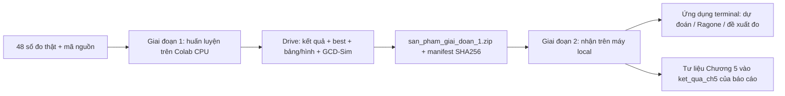

# Dự đoán điện cực siêu tụ — Chương 4–5

Dự đoán **Csp** (F/g), điện thế xả trung bình **V̄** (V), suy **Ed** (Wh/kg), **Pd** (W/kg), thời gian xả; so sánh 8 điện cực tại **cùng mật độ dòng J (A/g)**. Ứng dụng là CLI trong terminal, không phải giao diện web. Python 3.10+ (local đang dùng 3.12), NumPy 2.0+; mọi lệnh dưới đây chạy từ **Code/**.

Nguồn mục tiêu, số liệu, công thức: **“Dữ liệu điện hóa.docx” — NTM.Hồng & LD.Phúc**. Tài liệu Tân (PGCN), Giang (Electro:Sense), cô Nhạn chỉ tham khảo. KB1 nội suy mức chưa đo, KB2 ngoại suy dòng cao, KB3 chỉ đo ít mức; KB4 chỉ phân tích giới hạn với điện cực mới, **không hứa tìm tỉ lệ tối ưu**. Nhận xét ratio 0,1 tối ưu trong tài liệu nguồn phải được đối chiếu bằng so sánh cùng J, không áp đặt lên mô hình.

## Hai giai đoạn, một sản phẩm bàn giao



- **Giai đoạn 1 chỉ là Colab**. Các lượt kết nối trong nó gọi là **Phiên 1/2/3**.
- **Giai đoạn 2 chỉ là máy local**: nhận sản phẩm Colab, dùng mô hình, chép bảng/hình rồi hoàn thiện nội dung báo cáo.
- Nhóm `thu` là **chạy thử local**, không phải một giai đoạn và không phải kết quả đầy đủ.
- Không có kết quả huấn luyện/đánh giá được khẳng định trước khi thực sự chạy. ZIP chạy thử thiếu không dùng để kết luận luận văn.

## Cấu trúc và dữ liệu

| Đường dẫn | Nội dung |
|---|---|
| `data/` | 48 số đo thật = 8 điện cực × 6 mức 10/20/50/80/100/200 mA; [mô tả](data/README.md) |
| `gcdsim/` | Bộ sinh, hình và độ nhạy; [hướng dẫn riêng](gcdsim/README.md) |
| `ml/` | Chia fold, sinh dữ liệu trong fold, mô hình, đánh giá, CLI sử dụng và bàn giao |
| `notebooks/giai_doan_1_colab.ipynb` | Notebook Colab đầy đủ, có resume và đóng gói |
| `ket_qua/` | Kết quả nhận về; `ket_qua/thu/` chỉ chạy thử, không đưa lên Git |
| `tests/` | Chống rò rỉ, vật lý, resume và an toàn bàn giao |
| `../Report/Report/` | Báo cáo LaTeX ngoài kho mã; không bị CLI ghi đè nội dung chương |

Thí nghiệm GCD ba điện cực: mẫu khảo sát/Zn/Ag, cửa sổ điện áp 2,1 V. Nguồn chuẩn ML: `data/so_lieu_goc_dang_dai.csv`. Khối lượng điện cực khác nhau nên cùng mA **không phải cùng J**. Công thức: `Ed = Csp·2,1²/7,2`, `V̄ = Pd/(1000·J)`, `Δt = 3600·Ed/Pd`. Giữ số đo bất thường chưa được lab xác nhận lỗi. Sai số lặp 3%, cân 2%, thiết bị 1% là **giả định cần lab xác nhận**, không phải lần đo độc lập mới.

GCD-Sim mặc định `N=10000` mỗi điện cực: **48 × 10000 = 480.000 mẫu ảo**. XLSX lớn (~53,5 MB; **~60 giây local cho cả lệnh, đo sau khi chuyển sang ghi tuần tự**) nằm trong `ket_qua/gcdsim/`, bị Git bỏ qua; sinh lại bằng lệnh hoặc lấy trong sản phẩm Giai đoạn 1, **không đưa vào data/**. ML vẫn sinh lại dữ liệu chỉ từ phần học của mỗi fold, không đọc toàn bộ XLSX này để học.

## Giai đoạn 1 — huấn luyện trên Google Colab

### 1. Đưa đúng mã lên Colab

1. Mở [notebook](notebooks/giai_doan_1_colab.ipynb) bằng Google Colab; chọn runtime **CPU**, không cần GPU.
2. Mỗi phiên mới chạy lại các ô **Thiết lập 1–4**: mount Drive → lấy mã → pip install và CPU/phiên bản → kiểm ghi Drive.
3. Notebook có `REPO_URL = 'https://github.com/HMHPRSA2005/graphene-supercap-ml'`. **Tự commit/push thay đổi local lên remote trước khi clone/pull trên Colab**; notebook không thể lấy sửa đổi chưa đẩy. `pull --ff-only` không tự ghi đè thay đổi trong bản clone.
4. Không dùng GitHub: đặt `DUNG_ZIP = True`, tải ZIP mã nguồn hiện tại có `ml/`, `gcdsim/`, `data/`, `requirements.txt` (không phải ZIP kết quả). Mã làm việc ở `/content/Code`. Khi chọn clone mà `/content/Code` tồn tại không có `.git`, notebook thông báo rồi xóa bản sao mã đó trước khi clone; kết quả phải nằm trên Drive, không lưu trong thư mục mã tạm này.
5. Giữ nguyên `THU_MUC = '/content/drive/MyDrive/ScientificProject/ket_qua'`. `/content/` có thể mất khi ngắt, còn Drive giữ kết quả để resume.

### 2. Sinh GCD-Sim cho sản phẩm

Notebook chỉ bỏ qua XLSX đã tồn tại khi `zipfile.is_zipfile` và `ZipFile.testzip()` đều xác nhận không lỗi; XLSX hỏng/ghi dở được sinh lại. Ghi XLSX dùng tệp tạm rồi đổi tên nguyên tử. Hình/CSV bỏ qua khi có đầu ra. Ba lệnh tương đương trên local dùng `ket_qua` dưới đây; trên notebook dùng biến `$THU_MUC` trỏ Drive:

```sh
python -X utf8 -m gcdsim.gcdsim data/so_lieu_GCD.xlsx --out ket_qua/gcdsim/du_lieu_ao_480000.xlsx --seed 42
python -X utf8 -m gcdsim.ve_hinh data/so_lieu_GCD.xlsx ket_qua/gcdsim/hinh
python -X utf8 -m gcdsim.do_nhay data/so_lieu_GCD.xlsx ket_qua/gcdsim/do_nhay.csv
```

Ước lượng ghi XLSX **1–3 phút trên Colab, chưa đo trên Colab**; phụ thuộc CPU/Drive. Đầu ra được đưa vào ZIP, không đưa lên Git. Xem [gcdsim/README.md](gcdsim/README.md) để hiểu mode/sai số và các hình.

### 3. Chạy ba phiên, giữ nguyên thư mục để tiếp tục

| Phiên | Các ô cần chạy | Sau phiên |
|---|---|---|
| **Phiên 1** | `chinh`, `du_lieu_ao` | `ml.luu_best` → `THU_MUC/best/` bản đầu |
| **Phiên 2** | `so_mau` (10/100/1000/10000), `sigma` | `ml.luu_best` cập nhật |
| **Phiên 3** | `kb3`, `kb4`, `ml.so_sanh`, `ml.ve_hinh_ch5 --ung-dung`, `ml.luu_best` | Bảng/hình, best cuối, đóng gói và tải ZIP |

**Chạy lại cùng lệnh/cùng thư mục = tiếp tục**, bỏ qua đơn vị đủ mọi seed. Mỗi đơn vị là lần chia × mô hình × cách sinh × số mẫu × sigma × cấu hình chọn tham số; giữ đủ 10 seed. Nhóm có đơn vị trùng chỉ tính một lần, không dựa vào cột `nhom` (cột này giữ nhóm ghi đầu tiên). Không chạy hai CLI đồng thời ghi cùng CSV. Mỗi phiên mới chạy lại Thiết lập 1–4 rồi nhảy tới ô đang dở.

```sh
# Ví dụ trong phiên Colab; notebook đã có từng ô lệnh:
python -X utf8 -m ml.chay_kb1_kb4 --nhom so_mau --thu-muc "$THU_MUC" --n-jobs -1
python -X utf8 -m ml.luu_best --thu-muc "$THU_MUC"
python -X utf8 -m ml.dong_goi --thu-muc "$THU_MUC" --chi-tien-do
```

`--chi-tien-do` chỉ in số đơn vị đủ mọi seed/mục còn thiếu, không tạo ZIP. Tiến độ là **tổng đơn vị cần có riêng từng nhóm**, kể cả đơn vị đã chạy ở nhóm trước; khác cột đơn vị mới trong bảng thời gian. Không chạy kiểm kê khi bộ chạy đang ghi CSV. `--kiem-tra-ghi` kiểm ghi/phục hồi CSV UTF-8 ngay trên Drive. Nhật ký `.pending.json` cho phép phục hồi khi mất kết nối. Chỉ dùng `--bo-don-vi-do-dang` khi thông báo yêu cầu và đã sao lưu; resume thông thường không cần cờ này.

### Ngân sách và thời gian

MLP dùng ngân sách **6000 bước Adam**, làm tròn lên đủ vòng học (không giữ số epoch cố định khi tăng mẫu); vòng chọn tham số dùng 2000 bước. GPR nhóm đầy đủ học tối đa **300 hàng**, SVR tối đa **2000 hàng**, giữ mọi điểm thật và cân bằng theo điểm gốc; số hàng thật dùng nằm trong cột `so_hang_hoc`. Chọn tham số lồng nhau dùng `n_ao_chon=3` như nhau cho mọi tổ hợp, lần học ngoài dùng số mẫu đầy đủ. GPR không giữ toàn bộ 480k hàng khi fit nên đường GPR Hình 5.4 không thể diễn giải là lợi ích từ 480k hàng độc lập. Dữ liệu ảo không làm tăng cỡ mẫu lab độc lập.

**Phép đo mới trên local (một luồng, đủ 10 seed, gồm chọn tham số lồng nhau + sinh dữ liệu + học + dự đoán):** CPU Intel64 Family 6 Model 165, 16 luồng hệ điều hành. Dùng một fold KB1 `r0.025_m2` và một fold KB2 `r0.025_m6`, cách C, `n_ao=10000`, cấu hình nhóm đầy đủ; không rút gọn lưới/ngân sách.

| Fold | MLP | SVR | GPR | Bảng sinh mỗi seed |
|---|---:|---:|---:|---:|
| KB1 | 159,60 s | 11,88 s | 44,29 s | 47 thật + 470.000 ảo = 470.047 hàng |
| KB2 | 146,41 s | 10,95 s | 34,02 s | 47 thật + 470.000 ảo = 470.047 hàng |

48 điểm chỉ có khi khớp toàn bộ: 480.000 ảo + 48 thật. Fold không bao giờ sinh từ điểm bị giấu. Số hàng fit thực tế: MLP 470.047, SVR 2000, GPR 300. MLP ở cỡ này làm tròn 6000 lên 3 vòng ×2351 lô = 7053 bước; không phải đúng 6000 bước khi làm tròn vòng.

Kiểm bộ nhớ riêng khi `tao_tap_hoc` sinh toàn bộ 48 điểm cách C ×10000: **480.048 hàng**, `DataFrame.memory_usage(deep=True)` **86,98 MiB**, đỉnh **tracemalloc 96,92 MiB**, 2,36 giây local. Đây là bộ nhớ Python theo phép đo, **không phải đỉnh RSS của cả tiến trình/sklearn**; mỗi worker có bảng riêng, Colab có thể khác. Không giữ các bảng 480k của nhiều seed đồng thời; mỗi đơn vị sinh/học lần lượt theo seed, GPR/SVR lấy mẫu con trước fit.

**Phương pháp ước lượng Colab 2 nhân, chưa đo trên Colab:** giả định mỗi worker Colab chậm **2×** một luồng local và chạy 2 worker, nên thời gian ≈ tổng thời gian đơn luồng local ×2/2. Mức ×10000 thêm 32 fold KB1 + 8 fold KB2 cho mỗi MLP/SVR/GPR = 120 đơn vị mới; tổng local đo đại diện ngoại suy `32·(159,60+11,88+44,29) + 8·(146,41+10,95+34,02)` ≈8435 giây, tức **thêm ~2,34 giờ**. Cộng vào ước lượng cũ của so_mau (~1,9 giờ). Các nhóm không đổi giữ ước lượng cũ của kho mã, **chưa đo lại toàn nhóm**; không coi đây là thời gian bảo đảm hay kết quả đo trên Colab.

| Nhóm theo thứ tự notebook | Đơn vị mới (không tính đơn vị đã chạy ở nhóm trước) | Colab 2 nhân (ước lượng) |
|---|---:|---:|
| chinh | 376 | ~1,8 giờ (ước lượng cũ) |
| du_lieu_ao | 480 | ~3,7 giờ (ước lượng cũ) |
| so_mau | 360 | **~4,3 giờ**, đã thêm ×10000 |
| sigma | 360 | ~2,8 giờ (ước lượng cũ) |
| kb3 | 400 | ~2,2 giờ (ước lượng cũ) |
| kb4 | 128 | ~0,5 giờ (ước lượng cũ) |
| **Tổng** | **2104** | **~15,3 giờ**, chưa gồm ghi GCD-Sim/đóng gói |

Phiên 1 ~5,5 giờ; **Phiên 2 ~7,1 giờ** (chưa vượt mốc ~10 giờ nên không tách ×10000 thành phiên riêng); Phiên 3 ~2,7 giờ + sinh bảng/hình/đóng gói. Colab thay CPU/hạn mức có thể chậm hơn đáng kể; luôn theo ETA thực tế, dừng/kết nối lại và resume cùng thư mục nếu cần. Các nhóm độc lập không có nghĩa là được chạy đồng thời ghi cùng CSV.

### 4. Sản phẩm phải tải về

Cuối Phiên 3 chạy các ô so sánh/sinh hình/lưu best rồi:

```sh
python -X utf8 -m ml.so_sanh --thu-muc "$THU_MUC"
python -X utf8 -m ml.ve_hinh_ch5 --thu-muc "$THU_MUC" --ung-dung
python -X utf8 -m ml.luu_best --thu-muc "$THU_MUC"
python -X utf8 -m ml.dong_goi --thu-muc "$THU_MUC" --out san_pham_giai_doan_1.zip
```

Notebook lưu ZIP tại **`/content/drive/MyDrive/ScientificProject/san_pham_giai_doan_1.zip`**, rồi `files.download` tải về máy. Nếu tải trình duyệt thất bại, tải đúng tệp đó từ MyDrive/ScientificProject. **Cần ZIP toàn bộ sản phẩm, không chỉ thư mục best.** Gốc ZIP là nội dung thư mục kết quả + `manifest.json`, không bọc thêm `ket_qua/`.

Bắt buộc: `ket_qua_kb1_kb4.csv`, `moi_truong.json`, `best/best_{KB1,KB2,chung,co_khoang}.{joblib,json}`, `bang_ch5/` CSV/TeX, `hinh_ch5/` PNG/PDF, `so_sanh/` CSV/PDF, `gcdsim/du_lieu_ao_480000.xlsx`, `gcdsim/hinh/`, `gcdsim/do_nhay.csv`, mọi đơn vị sáu nhóm chính đủ seed. Manifest ghi thời điểm UTC, commit (nếu có), phiên bản thư viện, tiến độ từng nhóm, danh sách tệp/kích thước/SHA256 và mục thiếu. Thiếu → lệnh dừng và liệt kê chính xác cần chạy gì. `--cho-phep-thieu` chỉ dành cho chạy thử local, ZIP vẫn ghi rõ mục thiếu.

Đóng gói còn kiểm XLSX GCD-Sim không lỗi CRC và so thời điểm sửa: tệp trong `best/`, `bang_ch5/`, `hinh_ch5/`, `so_sanh/` **cũ hơn `ket_qua_kb1_kb4.csv`** sẽ bị đánh dấu chưa cập nhật; thông báo nêu đúng ô notebook cần chạy lại. Sau khi resume thêm thực nghiệm, chạy lại các ô xuất sản phẩm/best cuối rồi mới đóng gói, không dùng hình/best cũ để báo cáo.

Best được chọn theo MAPE(Csp + Pd)/2 trên điểm thật bị giấu, chỉ cấu hình đủ lần chia được xếp hạng, bỏ đối chứng `_bo_0.075` và **gng_r/pgcn_r chỉ thuộc phụ lục**; tham số lấy tổ hợp được chọn phổ biến nhất trong các fold. `best_KB1` cho nội suy, `best_KB2` cho ngoại suy, `best_chung` trung bình KB1/KB2, `best_co_khoang` tốt nhất trong nhóm có sd. Mô hình `.joblib` đã **khớp lại trên toàn bộ 48 số đo để sử dụng, không phải kết quả kiểm tra**; JSON giữ cấu hình/điểm kiểm tra/phiên bản. Không dùng `--cho-phep-thieu` để tạo best cho kết luận chính.

## Giai đoạn 2 — trên máy local: nhận sản phẩm, ứng dụng, báo cáo

### 1. Cài môi trường và đặt ZIP

```sh
python -m venv .venv
# Windows: .venv\Scripts\activate
# Linux/macOS: source .venv/bin/activate
python -m pip install -r requirements.txt
```

Đặt `san_pham_giai_doan_1.zip` trong `Code/` (hoặc truyền đường dẫn tuyệt đối). **Chỉ mở sản phẩm do chính bạn tạo/tin cậy**: joblib/pickle có thể thực thi mã; SHA256 chỉ phát hiện tệp thay đổi, không xác minh tác giả. **Khuyên nhận vào `ket_qua` mới/rỗng**, hoặc thư mục riêng như `ket_qua_nhan`. Nếu bất kỳ tệp ZIP trùng tệp đích, `nhan`/`tat_ca` mặc định dừng, liệt kê tệp xung đột, không ghi đè. Chỉ sau khi sao lưu, thêm `--ghi-de` để cho phép thay thế (lệnh in từng tệp sẽ thay).

### 2. Chạy toàn tuyến trên local

```sh
python -X utf8 -m ml.giai_doan_2 tat_ca san_pham_giai_doan_1.zip --thu-muc ket_qua --bao-cao ../Report/Report
```

Lệnh lần lượt:

1. **nhan**: từ chối đường dẫn ZIP vượt thư mục, tên trùng, symlink; kiểm kích thước/SHA256 toàn bộ tệp trước khi ghi đích; kiểm xung đột ghi đè; **tính lại** tiến độ/mục thiếu từ cây đã giải nén (in cả manifest nếu khác); so sánh phiên bản local/Colab; nạp thử mỗi `best_*.joblib` bằng `tai_best`. Trước khi nạp pickle, so NumPy/scikit-learn với JSON; lệch phiên bản thì thông báo rõ và khớp lại một lần từ JSON để sử dụng, không phải kết quả kiểm tra.
2. **ung_dung**: dùng `best_chung` và `best_co_khoang` cho đủ 8 ratio → `ket_qua/ung_dung/best_chung/` và `best_co_khoang/`, mỗi ratio một XLSX (dự đoán, thông tin, đề xuất đo) + PNG Ragone: **16 XLSX + 16 PNG**. Mỗi best chỉ nạp/khớp một lần rồi dùng lại cho 8 ratio; `tat_ca` còn dùng lại mô hình đã nạp thử khi nhận. Không có sd thì ghi rõ không đề xuất theo độ bất định, không bịa khoảng.
3. **bao_cao**: chép `bang_ch5/*.tex`, `hinh_ch5/*.pdf` (PNG chỉ nếu thiếu PDF cùng tên), `so_sanh/*.pdf` vào `../Report/Report/ket_qua_ch5/`. Giữ tên bảng/hình; hình so sánh thêm tiền tố `so_sanh_` để không đụng tên. `README.txt` ghi từng tên đích ← đường dẫn nguồn thực tế. Khi cập nhật, thay sạch thư mục `ket_qua_ch5/` **chỉ nếu README.txt có dấu nhận diện do công cụ tạo**; nếu thiếu dấu thì từ chối để không xóa thư mục của người dùng. Không tự sửa tệp đã sinh trong thư mục này; đặt nội dung tự viết ở ngoài.

Có thể chạy từng bước để xử lý lỗi:

```sh
python -X utf8 -m ml.giai_doan_2 nhan san_pham_giai_doan_1.zip --thu-muc ket_qua
python -X utf8 -m ml.giai_doan_2 ung_dung --thu-muc ket_qua
python -X utf8 -m ml.giai_doan_2 bao_cao --thu-muc ket_qua --bao-cao ../Report/Report
```

Ví dụ nhận lại có chủ đích **sau sao lưu**: `python -X utf8 -m ml.giai_doan_2 nhan san_pham_giai_doan_1.zip --thu-muc ket_qua --ghi-de`; cờ này cũng dùng được với `tat_ca`. Không cần cờ khi nhận vào thư mục mới/rỗng.

### 3. Dùng ứng dụng terminal theo nhu cầu

```sh
python -X utf8 -m ml.du_doan --ti-le 0.1 --best ket_qua/best/best_chung.joblib --out ket_qua/ung_dung/tuy_chon.xlsx
python -X utf8 -m ml.du_doan --ti-le 0.1 --dong-mA 10 30 70 200 --best ket_qua/best/best_co_khoang.joblib --out ket_qua/ung_dung/co_khoang.xlsx
# Hoặc nhập mật độ dòng trực tiếp: --J 5 10 20
```

Mỗi tệp kèm PNG Ragone cùng tên, chồng điểm đo. Đề xuất chọn dòng 10–200 mA bước 10 **chưa đo**, có σ_logCsp lớn nhất. Khoảng 95% chỉ có khi mô hình trả sd log; là biên Csp/V̄/Ed/Pd, không suy khoảng Δt hoặc khoảng đồng thời. Cột `khong_hop_le` đánh dấu dự đoán không hữu hạn/≤0, giữ nguyên chứ không sửa. GPR + C có thể dao động giữa các mức neo, CLI sẽ cảnh báo; không mặc định dữ liệu ảo tốt hơn thật.

Nếu không dùng best, `ml.du_doan --mo-hinh gpr --cach A ...` khớp lại theo cấu hình mặc định/tùy chọn `--tham-so JSON`; **không phải lựa chọn tối ưu đã kiểm tra**. Mặc định A trung tính; chọn A/B/C/D theo Bảng 5.3.

So sánh lại tại cùng J trên local khi cần (khớp lại để sử dụng, không phải kiểm tra):

```sh
python -X utf8 -m ml.so_sanh --thu-muc ket_qua
# Phân tích mở rộng ngoài miền chung:
python -X utf8 -m ml.so_sanh --thu-muc ket_qua/so_sanh_toan_bo --mien toan_bo
```

Mặc định GPR/chọn dạng hàm/MLP, cách A, 60 điểm J log-đều trong **giao miền đo của 8 điện cực**. `--mien toan_bo` dùng hợp miền, đánh dấu `ngoai_mien_do` theo từng điện cực. Đầu ra `so_sanh/`: `du_doan_luoi.csv`, `xep_hang.csv`, `tom_tat.csv`, các hình Csp–J/Ragone/xác suất tốt nhất dạng PNG/PDF. Hạng Csp và Pd là hai tiêu chí riêng (Ed cùng hạng Csp). Dải qua seed là phân tán qua seed, không phải khoảng dự đoán; Monte Carlo giả định điện cực độc lập, không phải xác suất thực nghiệm đã hiệu chuẩn.

### 4. Hoàn thiện báo cáo — cần thao tác nội dung, không chỉ chép tệp

Đọc `ket_qua/manifest.json` để chắc sản phẩm đầy đủ; đối chiếu CSV/best JSON trước khi diễn giải. Đọc `../Report/Report/ket_qua_ch5/README.txt` để biết tệp nào thực sự đã chép. Trong LaTeX dùng `\input{ket_qua_ch5/bang_5_2.tex}` (cần `booktabs,longtable`), `\includegraphics{ket_qua_ch5/hinh_5_4.pdf}`. Viết nhận xét từ kết quả chạy thật, nêu giới hạn 48 điểm, sai số giả định và độ bất định; đối chiếu ratio 0,1 ở cùng J. Sau cùng tự biên dịch/kiểm bố cục báo cáo. **CLI chỉ chép tư liệu, không tự viết kết luận, không thay nội dung chương và không biên dịch LaTeX.**

Nếu sinh lại `ml.ve_hinh_ch5 --thu-muc ket_qua --ung-dung` hoặc `ml.so_sanh`, chạy lại `ml.giai_doan_2 bao_cao ...` để cập nhật bản chép. Hình 5.9–5.10 từ `ve_hinh_ch5` mặc định GPR cách A, không tự nhận là hình từ best; dự đoán best ở `ung_dung/`.

## Tùy chọn — chạy thử local trước khi lên Colab

Không cần huấn luyện đầy đủ trên máy cá nhân. Nhóm `thu` dùng 2 seed, lưới rút gọn, đại diện mỗi kịch bản. Ví dụ kiểm đường đi với GPR, một seed và 4 đơn vị đầu (KB1/KB2):

```sh
python -X utf8 -m ml.chay_kb1_kb4 --nhom thu --thu-muc ket_qua/thu --n-jobs 1 --mo-hinh gpr --seeds 0 --toi-da-don-vi 4
python -X utf8 -m ml.luu_best --thu-muc ket_qua/thu --cho-phep-thieu
python -X utf8 -m ml.ve_hinh_ch5 --thu-muc ket_qua/thu --ung-dung
python -X utf8 -m ml.dong_goi --thu-muc ket_qua/thu --out ket_qua/thu_san_pham.zip --cho-phep-thieu
# Nhận và báo cáo ở thư mục ngang hàng với nguồn, không lồng vào ket_qua/thu:
python -X utf8 -m ml.giai_doan_2 tat_ca ket_qua/thu_san_pham.zip --thu-muc ket_qua/thu_nhan --bao-cao ket_qua/thu_bao_cao
```

Muốn chạy trọn `thu`: bỏ `--mo-hinh`, `--seeds`, `--toi-da-don-vi`. ZIP thử vẫn ghi rõ mọi nhóm/mục thiếu, không phải sản phẩm luận văn. Kiểm tra mã:

```sh
python -m pip install pytest
python -X utf8 -m pytest -q tests
```

## Kịch bản → Chương 5

| Nhóm / kịch bản | Câu hỏi | Tư liệu chính |
|---|---|---|
| `chinh` / KB1, KB2 | Nội suy/ngoại suy, có đối chứng bỏ ratio 0,075 | Bảng 5.2; Hình 5.2–5.3 |
| `du_lieu_ao` / KB1, KB2 | A thật; B nhiễu Gauss; C neo GCD-Sim; D đường khớp | Bảng 5.3, Wilcoxon/Holm khi có đủ cặp |
| `so_mau` / KB1, KB2 | **10, 100, 1000, 10000** mẫu ảo/điểm | Hình 5.4 (trục symlog, nhãn ×n; A tại ×0) |
| `sigma` / KB1, KB2 | Sai số lặp 1/3/5/10% | Hình 5.5 |
| `kb3` / KB3 | Giữ k=1..5 mức thấp nhất/trải đều | Hình 5.6; bảng k đạt ngưỡng |
| `kb4` / KB4 | Giới hạn chuyển sang tỉ lệ chưa đo | Bảng 5.6 |
| Khoảng dự đoán | PICP/W_rel trên điểm thật bị giấu | `do_phu.tex`, `do_phu_tung_seed.tex` |
| `ml.ve_hinh_ch5 --ung-dung` | Ragone/đề xuất đo minh họa khớp toàn bộ | Hình 5.9–5.10, bảng `ung_dung_*` |
| `ml.so_sanh` | 8 điện cực cùng J, không suy tỉ lệ tối ưu ngoài miền đã đo | CSV + PDF trong `so_sanh/`, bản chép `so_sanh_*.pdf` |

## Nguyên tắc chống rò rỉ và diễn giải

1. Chia **số đo thật trước**, không chia ngẫu nhiên bảng ảo 480k hàng.
2. Mỗi fold ngoài/trong chỉ dùng phần học thật để khớp hàm, chuẩn hóa và sinh ảo; kiểm tra chỉ điểm thật bị giấu. Không dùng XLSX GCD-Sim toàn bộ để thay cơ chế này.
3. Chọn tham số lồng nhau trong phần học; không tối ưu trên kiểm tra ngoài; sau chọn mới chạy nhiều seed.
4. Chuẩn hóa J từ phần học thật; thang đầu ra từ bảng học. KB4 dùng ratio liên tục, không one-hot điện cực bị giấu.
5. Sai số tính theo điện cực trong mỗi seed rồi trung bình qua seed; các mẫu ảo/seed không biến thành số điện cực độc lập mới. Kiểm định 8 điện cực có công suất thấp, báo giới hạn cùng p.
6. Mọi dự đoán từ best/CLI ứng dụng/so sánh là **khớp lại để sử dụng, không phải kết quả kiểm tra**. Độ tin cậy xem KB1/KB2; không tự tạo dải bất định nếu mô hình không có sd.

## Phụ lục — không chạy mặc định

Notebook có `CHAY_PHU_LUC = False`; đầu ra riêng tại **`THU_MUC + '/phu_luc'`** trên Colab (local: `ket_qua/phu_luc`). Chỉ bật khi cần tham khảo; kết quả đồ thị và KB5 mang tiền tố `phu_luc_`, không trộn vào kết luận chính/best. PGCN-R là bản tự cài theo GNG/LLCS, chưa có mã gốc của Tân; không khẳng định tái lập chính xác.

```sh
python -X utf8 -m ml.chay_kb1_kb4 --nhom phu_luc_do_thi --thu-muc ket_qua/phu_luc --n-jobs -1
python -X utf8 -m ml.chay_kb5 --thu-muc ket_qua/phu_luc --n-ao 1000 --moi-buoc 2000
python -X utf8 -m ml.ve_hinh_ch5 --thu-muc ket_qua/phu_luc
```

Đồ thị dùng ngân sách 20000 mẫu trình bày (vòng chọn 4000), không phải số epoch cố định. KB5 giấu mức 3/5, học mức 1/2/4/6; cố định bộ mã hóa/thang đầu ra từ đợt đầu; `buoc` đếm mẫu mới. `mlp_hoc_lai` khớp mới trên mọi mẫu đã thấy. `--nhanh` chỉ để thử riêng; `--doi-thu-tu` thêm hoán vị ba đợt đầu, chi phí xấp xỉ 6 lần. Thời gian cũ phụ lục đồ thị ~0,9 giờ, KB5 ~0,6 giờ (đảo thứ tự ~3,7 giờ) chỉ ngoại suy local, chưa đo trên Colab, không thuộc ba phiên chính. Chạy phụ lục xong cần sinh lại bảng/hình và đóng gói lại nếu muốn bàn giao chúng.
